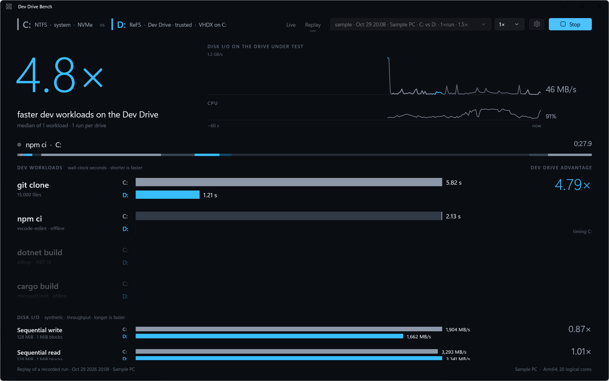

# Dev Drive Bench

A WinUI 3 showcase that races real developer workloads on the **system drive** and a **Dev Drive**
and shows, while they run, what the Dev Drive actually buys you.



One number up top (median Dev Drive advantage across real workloads), a live trace of disk I/O on
the drive under test, the whole run as a time strip, and one row per test: the system drive lane
over the Dev Drive lane on a shared scale, labeled directly. No legends, no paragraphs.

## Run it

Requirements: Windows 11 with a Dev Drive, .NET 10 SDK, [WinApp CLI](https://github.com/microsoft/winappcli) 0.7+, Developer Mode.

```powershell
cd src\DevDriveBench
winapp run .
```

| Key | Action |
|-----|--------|
| `F5` | Run (Live) or play (Replay) |
| `Esc` | Stop |
| `F11` | Full screen (stage mode) |

- **Live** runs the benchmark on this machine. **Runs** (default 1) is iterations per drive per test;
  raise it to gather steadier data.
- **Replay** plays a recorded run back at its original pace (1×, or 2–8× to skip ahead). Use it
  if the stage machine has no Dev Drive, no network, or no time. The app ships a real recorded
  sample; every Live run you make is added to the list.
- The gear menu picks tests, the git fixture size, and the Dev Drive (when there are several).

## What is measured

| Test | What is timed | Needs |
|------|---------------|-------|
| Disk I/O | 128 MiB sequential write/read (1 MiB blocks), 2,000 random 4K reads/writes at QD1, unbuffered + write-through | — |
| git clone | `git clone --no-hardlinks` of a local 15,000-file repo (1,200 with Quick) | git |
| npm ci | offline `npm ci` of microsoft/vscode-eslint from a cold cache on the drive | npm, network for first prep |
| dotnet build | `dotnet build` of dotnet/eShop on .NET 10 (`eShop.Web.slnf`: web app, services, Aspire AppHost and tests; pinned commit) against a cold NuGet cache on the drive, build servers cold each run | dotnet, network for first prep |
| cargo build | offline `cargo build` of microsoft/edit from a cold `CARGO_HOME` on the drive | cargo, network for first prep |

Tests whose tool is not installed are unchecked; the gear menu has an **Install** button per test
that runs `winget install` for what it needs (Git; Node.js LTS; .NET 10 SDK; for cargo, VS 2022
Build Tools with the C++ workload — plus the ARM64 toolset on ARM64 — then rustup and
`rustup default stable`). Installs request the OS architecture (`--architecture arm64` on ARM64),
so an ARM64 machine never gets an emulated toolchain by default. Installers may ask for elevation.
The app re-reads PATH afterwards, so the test is ready without a restart. A test that fails (no
network, low disk) shows as a skipped row with the reason.

**Methodology.** Each test prepares its fixture once, then runs N cold iterations on the system
drive and N on the Dev Drive. Every workload iteration re-copies its package cache cold onto the
drive under test, so cache, sources, and build output all live on the drive being measured; only the
tool invocation itself is timed. With N ≥ 2 the first iteration is a discarded warm-up and the median
of the rest is reported (ticks on each lane show every raw run; the dim tick is the warm-up). With
N = 1 that single run is reported. Build servers are shut down before and after every timed
`dotnet build` (untimed), so the second drive never inherits warm MSBuild/compiler processes from
the first. The headline is the median advantage
across workloads; synthetic disk numbers are shown separately and never feed the headline.

The disk pass runs first, while the machine is quiet. The git fixture is written with
`git fast-import` (one packed bare repo, no working tree), which keeps preparation to about a second
even where on-open antivirus scanning of thousands of new files is slow.

## Data

Every Live run is saved to `Documents\DevDriveBench\Runs`:

- `*.json` — the complete recording: machine (including OS architecture), drives (file system, Dev
  Drive/trusted, bus, VHDX backing file), `fsutil devdrv query` output, plan, each tool's version
  and the architecture of the binary that really runs (git's own `git.exe`, `node.exe` behind
  `npm.cmd`, the toolchain's `cargo.exe` behind rustup's proxy), every timestamped event (phases,
  raw per-iteration values, live disk samples, 4 Hz disk/CPU activity) and a results summary. This
  is what Replay plays. A tool whose architecture doesn't match the OS (e.g. x64 node on ARM64) is
  flagged next to its row.
- `*.csv` — one row per raw iteration (`test_id, drive_role, iteration, value, discarded,
  reported_value, advantage, tool, tool_version, tool_arch, os_arch`, plus machine and drive
  context) for spreadsheets.

Headless data gathering uses the same engine and produces the same files:

```powershell
dotnet run --project src\DevDriveBench.Cli -- --runs 5 --tests disk,git-clone
dotnet run --project src\DevDriveBench.Cli -- --list      # drives, Dev Drive status, tools + architecture
```

## Layout

```
src/DevDriveBench.Engine   benchmarks, event stream, recordings, replay, stats (no UI)
src/DevDriveBench          WinUI 3 app
src/DevDriveBench.Cli      headless runner
tests/                     engine tests (dotnet test)
```

The benchmark engine is ported from [crutkas/devdrive](https://github.com/crutkas/devdrive)
(`crutkas-drive-space-analyzer` branch), MIT License.
